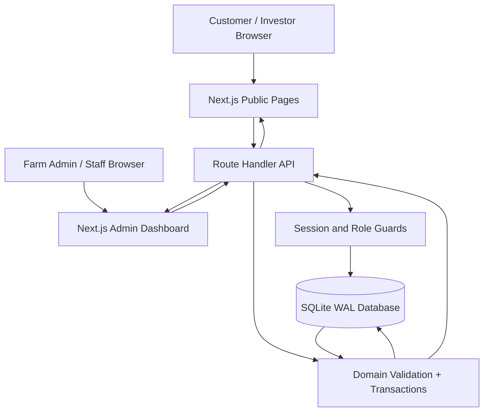
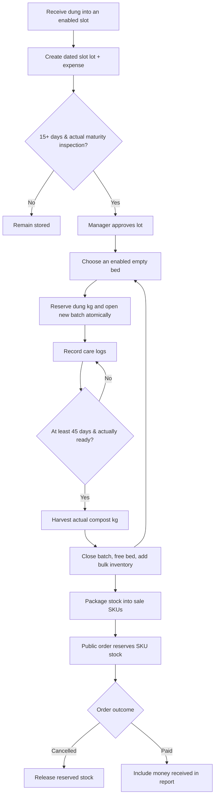

# আমাদের খামার — System Architecture v1.1

## Input basis and chosen implementation

The supplied React Artifact was a **rendered HTML demo** with hardcoded 2025 dates, bed quantities, slot stocks, price assumptions and investor KPI projections. Its site architecture specified **Next.js + Tailwind, React, Hind Siliguri and Lucide**, and the following public site map: About → farm story/8×5 model/team; Dashboard → 8 bed status/5 slot monitoring/production report; Knowledge → compost/how-to/video; Products → compost and worms; Order → cart and delivery; Blog → updates; Contact → map and form. This project turns those sections into data-backed routes and a permission-controlled management module.

## High-level diagram

## Core data workflow

## Modules & endpoints

- Public GET: `/api/public` (published products, posts, bed/slot aggregate); POST `/api/public/order` (stock-reserved order); POST `/api/public/inquiry` (stored contact message).
- Authentication: POST `/api/auth/login`, POST `/api/auth/logout`, GET `/api/auth/me`.
- Staff/Admin data: GET `/api/admin/state?month=YYYY-MM`, GET `/api/admin/inventory-history`.
- Farm layout (Admin): POST `/api/admin/beds`, PATCH/DELETE `/api/admin/beds/:id`; POST `/api/admin/slots`, PATCH/DELETE `/api/admin/slots/:id`. DELETE is only permitted when no history references that unit.
- Intake: POST `/api/admin/slot-lots`; POST `/api/admin/slot-lots/:id/approve` (idempotent after initial approval).
- Production: POST `/api/admin/batches`; POST `/api/admin/care`; POST `/api/admin/batches/:id/harvest`.
- Stock: POST `/api/admin/packaging`; admin-only POST `/api/admin/adjustment`.
- Sales: PATCH `/api/admin/orders/:id` with allowed status transitions.
- Finance/tasks: POST `/api/admin/expenses`, POST `/api/admin/tasks`, PATCH `/api/admin/tasks/:id`.
- Content: admin-only POST `/api/admin/products`, POST `/api/admin/posts`, PATCH `/api/admin/settings`.
- Contact: PATCH `/api/admin/inquiries/:id`.
- Health: GET `/api/health`.

## Financial reporting rules

`income(month)` is the sum of orders whose `payment_status` is `paid` and whose `paid_at` is inside the selected month, excluding cancelled orders. `expense(month)` is the sum of entered expenses with `spent_on` in that month, including intake costs automatically created when a dung lot includes a material cost. `net(month) = income(month) - expense(month)`. This is a simplified report, not GAAP accrual net income. **Never infer a 68% gross margin without actual costs and sales data.**

## Dynamic layout & backwards compatibility

- The initial 8 beds and 5 slots are first-run templates, not limits. An initialisation marker prevents recreation of removed units during startup.
- `beds.enabled`, `slots.enabled`, `code`, `capacity_kg`, and `notes` are editable. Aggregates and public views include **only enabled** beds/slots; admin state returns enabled and disabled units together with historical activity counts.
- Beds with an active batch cannot be archived. Slots with any remaining dung cannot be archived. History-linked units cannot be hard-deleted. Operator may restore them at any time.
- Existing SQLite files upgrade in place without losing lots, batches, harvest records or orders; keep the original database files intact. Approval status is idempotent and approved lots are listed using their slot name and current remaining amount.

## Security & deployment requirements

- Admin initiated via CLI, no publicly accessible registration or default password.
- Password hashing: random-salted scrypt. Session stored as SHA-256 token hash, 7-day expiry, HttpOnly SameSite=Lax cookie.
- Staff/admin role restrictions in server routes; public mutations protected by basic rate limiter; common-origin checks for mutating routes.
- Parameterized SQLite statements, FK constraints, conditional UNIQUE constraint on active batch per bed, SQL transactions for material/stock/sales transitions.
- Use a persistent Node VPS and HTTPS; do not put SQLite under an ephemeral serverless deployment.
- For high concurrency, auditability, automated backups and payments at scale, plan migration to Postgres, a persistent job runner, notification service, and formal accounting ledger.

## Missing integrations intentionally not claimed

Payment gateway; automated delivery tracking; image hosting; laboratory verification, sensors/IoT telemetry, actual 24/7 weather observation; SMS/WhatsApp; true event-driven real-time streaming; staff/team directory management; external sales invoices. Current “live” display means database-driven UI, polling every 60s in a visible browser, and immediate refresh after administrative changes.
